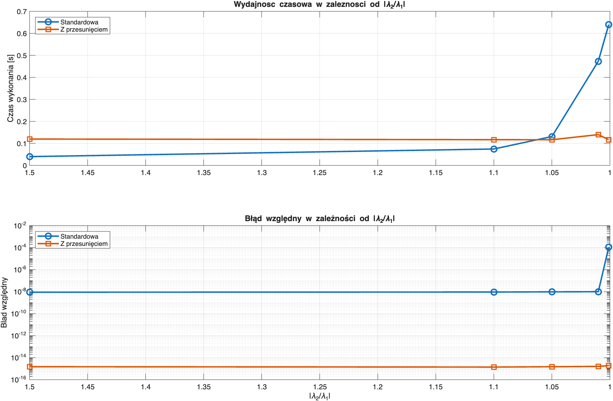

# Inverse power method

A MATLAB implementation of the **inverse power method**. It finds the
eigenvalue of a complex square matrix with the smallest modulus, together with
its eigenvector. The LU decomposition and the triangular solvers are written
from scratch.

Written for the Numerical Methods 2 course at the Faculty of Mathematics and
Information Science, Warsaw University of Technology. Comments and test output
are in Polish.

## How it works

The power method applied to $A^{-1}$ converges to the largest eigenvalue of
$A^{-1}$, which is $1/\lambda_{\min}$ of $A$. The code never forms the inverse:

1. Factorize once: $PA = LU$ with partial pivoting (`LU.m`).
2. Each iteration solves $A x = v$ with forward substitution
   (`forw_sub.m`, $Ly = Pv$) and back substitution (`back_sub.m`, $Ux = y$).
   Each solve costs $O(n^2)$.
3. Update $\lambda = 1 / (v^H x)$ and normalize $v = x / \lVert x \rVert$.
4. Stop when the relative residual
   $\lVert A v - \lambda v \rVert_2 / |\lambda| <$ `tol`,
   or after `maxIter` iterations.

The method converges linearly with rate $|\lambda_1 / \lambda_2|$, where
$\lambda_1$ and $\lambda_2$ are the two eigenvalues with the smallest moduli.
So it gets slow when they are close together.

`inverse_shifted.m` is a variant for comparison. It uses the current Rayleigh
quotient $\mu = v^H A v$ as a shift and factorizes $A - \mu I$ again on every
iteration. Each iteration costs $O(n^3)$, but it
converges in only a few steps no matter how close the eigenvalues are.

## Usage

```matlab
[lambda, v, errEst, iter] = inverse_power(A, tol, maxIter);
```

| | |
|---|---|
| `A` | square matrix (real or complex) |
| `tol` | tolerance on the relative residual |
| `maxIter` | iteration limit |
| `lambda`, `v` | eigenvalue with the smallest modulus and its unit eigenvector |
| `errEst` | final relative residual $\lVert Av - \lambda v\rVert / \lvert\lambda\rvert$ |
| `iter` | number of iterations performed |

## Files

| File | Purpose |
|---|---|
| `inverse_power.m` | Inverse power method |
| `inverse_shifted.m` | Shifted variant for comparison |
| `LU.m` | LU decomposition with partial pivoting, returns `L`, `U` and the permutation vector `p` |
| `forw_sub.m` / `back_sub.m` | Forward and back substitution |
| `test_lu_res.m` | Relative error $\lVert PA - LU\rVert / \lVert A\rVert$ for N = 5…500 |
| `test_lambda_res.m` | Correctness for positive, negative and complex eigenvalues, multiples of $I$, and widely separated spectra |
| `test_stop.m` | Checks that the stopping rule respects `tol` |
| `numtest1.m` | Time and accuracy vs. matrix size |
| `numtest2.m` | Iteration count vs. eigenvalue ratio $\lvert\lambda_2/\lambda_1\rvert$ |
| `numtest3.m` | Standard vs. shifted method: time and accuracy |
| `plot_performance_diff.m` | Plots the `numtest3` results |

Each test is a function, so you can run it by name, e.g. `test_lambda_res`.
The test matrices are built as $A = Q D Q^H$ with a random unitary $Q$, so
the exact eigenvalues are the known diagonal entries of $D$.

## Results

- The LU residual stays at machine precision (about $10^{-16}$–$10^{-15}$) up
  to N = 500.
- The smallest eigenvalue is recovered to a relative residual of about
  $10^{-15}$ for real, negative and complex spectra.
- The iteration count grows quickly as $|\lambda_2/\lambda_1| \to 1$: 16
  iterations at a ratio of 10, 315 at 1.1, and no convergence within 1000
  iterations at 1.01.
- The shifted variant needs 4–7 iterations whatever the ratio is. It is slower
  when the eigenvalues are well separated, because each iteration does a full
  LU. Once the ratio drops below about 1.05 it is faster, and it reaches
  $10^{-15}$ where the standard method stops at about $10^{-4}$.


